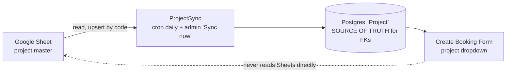
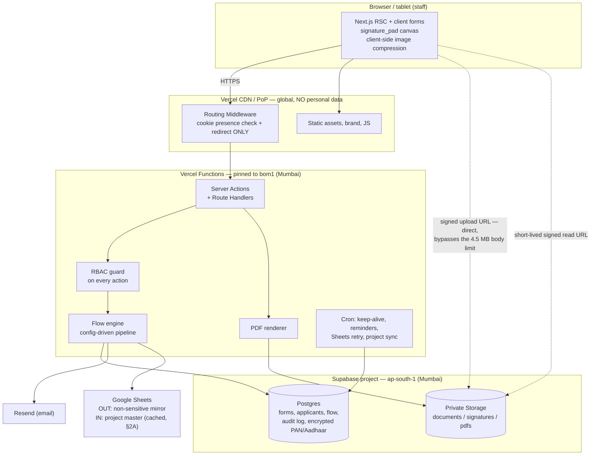
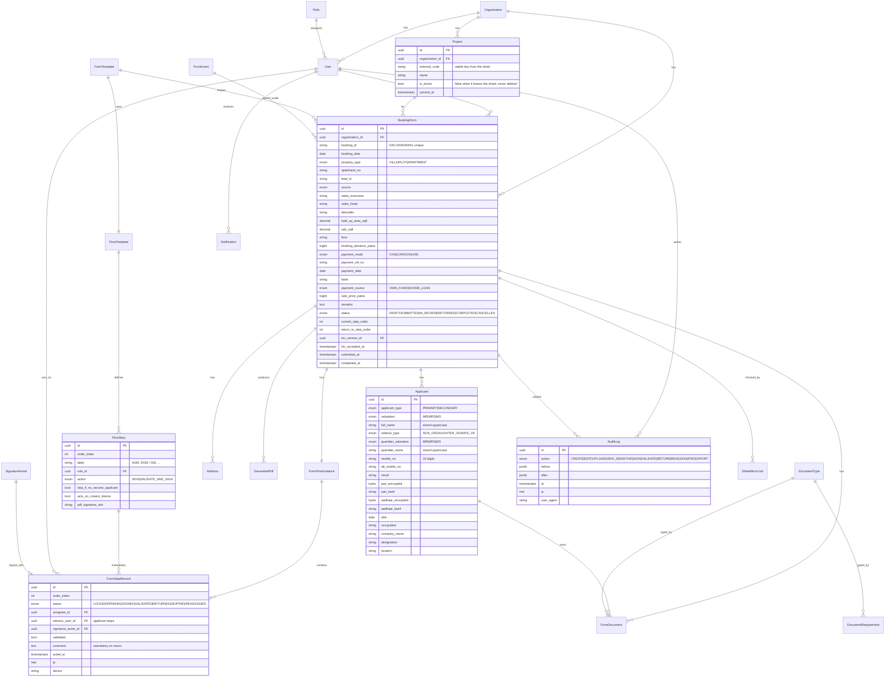
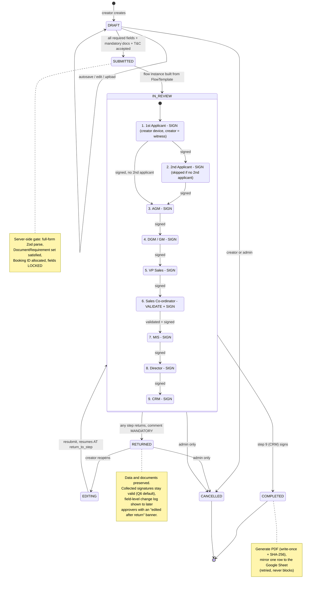

# PLAN.md — DAC Developers Booking Form Portal

**Stage 1 (planning) deliverable.** No application code written.
Date: 2026-10-22 · Status: **images verified — awaiting approval**

---

## 0. ✅ GATE CLEARED — reference images located and verified (2026-10-22)

Both photos were found in `C:\Users\…\Downloads` (saved 16:46, filenames carrying a stray double
dot: `booking-form..jpeg`) and copied into `/reference/` under the expected names. They were not
on disk when planning began, which is why this plan was first drafted from the written brief alone.

**I have now read both images and diffed them against `FIELD_MAP.md`:**

| Check | Result |
|---|---|
| Field inventory complete? | **Yes.** Every field printed on the paper appears in `FIELD_MAP.md`, and nothing in `FIELD_MAP.md` is absent from the paper. The brief's §2 was accurate. |
| `BoxInput` lengths | **Confirmed by 4× zoom** — Mobile 10, Alternate Mobile 10, Adhaar 12, D.O.B 8 (printed as 4 visual pairs). |
| Label corrections | **4 applied**, marked `[IMG]`: "**Adhaar** No" (not Aadhaar); "UDS (Sq.Ft**.**)" vs "Built-up Area (Sq.Ft)"; the vertical note; "Sale **Cum** Construction". |
| Vertical left-edge note | Read at 10× — **`*Agreed terms mentioned in the booking form`**. Q21 closed. |
| Signature strip | Confirmed 2 rows × 4 columns — row 1: 1ST Applicant ｜ AGM ｜ VP Sales ｜ CRM; row 2: 2ND Applicant ｜ DGM / GM ｜ MIS ｜ Director. **Managing Director is a ruled line, not a box**, above the CRM/Director column. No Sales Co-ordinator box exists on the paper — Q5 still stands. |
| T&C page | All 8 headings confirmed; footer is `For DAC Developers Pvt Ltd,` above `AUTHORIZED SIGNATORY`, alongside `APPLICANT (1)` and `APPLICANT (2)`. Body text **fully legible at 4× zoom** — transcription is now viable (Q8). |

**One residual risk, downgraded from blocking to manageable:** both images are 1280×960
(~150–195 KB). That is ample for labels and for transcribing the T&C, but thin for the
*pixel-faithful* geometry work in Phase 6 — I can confirm that a box exists, not its width to the
millimetre. A 300 dpi flatbed scan, or a straight-on shot at full camera resolution, would make
the Phase 6 comparison materially easier. Worth two minutes if the originals are to hand; not a
reason to delay approval.

---

## 1. My understanding of the form

Full field-by-field table with DB column, input type and validation: **see `FIELD_MAP.md`**
(74 data fields + 10 signature slots). Summary of the structure I will reproduce, in paper order:

1. **Header box** — Booking Date, Project Name, Property type (Villa / Plot / Apartment No +
   number), Sales Executive, Sales Head, Telecaller, Lead ID, Source, Booking ID (auto
   `DAC/2026/00001`).
2. **PERSONAL INFORMATION** (CAPITALS ONLY) — two identical blocks, Sole/First Applicant and
   Co/Second Applicant (optional), each with a photo box and 12 fields.
3. **COMMUNICATION ADDRESS** / **PERMANENT ADDRESS** — side-by-side, 4 lines each.
4. **PROPERTY DETAILS** — Built-up Area (Sq.Ft), UDS (Sq.Ft), Floor.
5. **PAYMENT DETAILS** — Booking Advance, Mode (Chq / Card / Online), Ref. No., Date, Bank,
   Payment Source (Own Funds / Home Loan), Sale Price + the printed note
   *"Excluding GST & Registration charges"*.
6. **REMARKS (if any)** — 3 lines.
7. **Signature strip** — row 1: 1st Applicant, AGM, VP Sales, CRM; row 2: 2nd Applicant,
   DGM / GM, MIS, Director; plus a Managing Director line above-right; plus the left-edge
   vertical note.
8. **Page 2 — TERMS & CONDITIONS FOR PROVISIONAL ALLOTMENT**, read-only, 8 sections, closing
   acceptance line, signed by Applicant (1), Applicant (2), and Authorized Signatory for DAC.

### Three structural things the brief leaves implicit

- **Salutation and relation are enums, not free text.** The paper pre-prints "Mr./Mrs./Ms." and
  "Son / Daughter / Wife of" as options to circle. I model `salutation` and `relation_type` as
  enums plus a free-text name rather than one string — it lets the PDF render the printed options
  with the correct one marked, exactly as on paper.
- **The applicant signature steps run on the creator's device, so they are not "pending on a
  login".** Pipeline steps 1–2 have no assignable user account. I assign them to the **creator**
  as capture agent and witness so the pipeline stays uniformly config-driven and fully audited.
  There is a real design choice here about whether capture happens before or after submit — see
  OPEN_QUESTIONS **Q1**.
- **`Sale Price` and `Booking Advance` are money** → `BIGINT` paise, never float (brief §7).

---

## 2. Stack decision

I accept the recommended stack. Deltas and justifications:

| Layer | Choice | Why this and not the alternative |
|---|---|---|
| Framework | **Next.js 15 App Router, TypeScript strict** | Server Actions give one place to enforce RBAC server-side; RSC keeps the read-only form replica cheap to render. |
| DB | **Postgres on Supabase, ap-south-1 (Mumbai)** | The only free-tier option with a real India region. Neon excluded (no India region) per brief. |
| ORM | **Prisma** | Over Drizzle: mature migration story, and `Decimal`/`BigInt` handling plus relation loading across a 16-table graph means far less hand-written SQL. Drizzle's edge-runtime advantage does not apply — we are pinned to a Node runtime in a single region by design. |
| Auth | **Auth.js v5 (Credentials) + Argon2id**, sessions in Postgres | Over Supabase Auth: we need admin-created accounts only, no public sign-up, and role checks inside our own DB transaction. Over Clerk: **Clerk stores user records outside India — a residency violation.** That is the decisive reason. |
| Validation | **Zod schemas shared client/server** + React Hook Form | One schema per section, re-parsed by the Server Action. The client copy is never trusted. |
| UI | **Tailwind + shadcn/ui**, plus custom paper-replica CSS | shadcn for dialogs/tables/toasts; the form sheet itself is hand-built CSS Grid so it matches the paper rather than a component library's idea of a form. |
| Storage | **Supabase Storage, private buckets**, behind a `StorageProvider` interface | Signed upload + signed read URLs. The interface makes an AWS S3 (ap-south-1) move a one-file change. |
| Signature | **`signature_pad`** → trimmed transparent PNG → private bucket | Store the image plus stroke metadata; never base64 in Postgres. |
| PDF | **`@react-pdf/renderer`**, with a documented fallback | See §4 — the highest-risk choice, argued explicitly. |
| Email | **Resend** free tier, behind a `Notifier` interface | Limits verified below. |
| Sheets | Service account, **two flows now**: mirror **out** on Completed, and project list **in** (cached) | Outbound is non-sensitive columns only, per brief §8A. Inbound is new — see §2A. |
| Tests | Vitest (flow engine, validators, money, Booking-ID allocation) + Playwright (happy path) | |

### Free-tier facts, verified 2026-10-22

**Supabase Free** — DB **500 MB** (the project goes **read-only** above it, even though 1 GB of
disk is provisioned); Storage **1 GB**; Egress **5 GB/mo**; max upload 50 MB; **2 free projects**;
**paused after ~7 days without database activity**; **no automatic backups**. Pro removes pausing
and adds backups.

**Resend Free** — **3,000 emails/month but capped at 100/day**, 1 verified domain; sending
**pauses** at the cap on the free plan. *The daily cap, not the monthly, is our binding
constraint* — see §5.

**Vercel** — `bom1` = `ap-south-1`, Mumbai **is** an available function region. Region count by
plan: **Hobby = single region** (sufficient for us), Pro = 5. Hobby is **personal, non-commercial
use only** — DAC must be on **Pro before production**. Hobby's ~10 s function timeout vs 300 s on
Pro also matters for PDF generation.

---

## 2A. Project list from Google Sheets (added 2026-10-22)

DAC maintains project names in a Google Sheet, so the app must read them. This **reverses** the
direction the brief set in §8A (*"the app never reads business data back from the sheet"*), and a
naive live lookup would put Google on the critical path of every booking. It is built as a
**cached read-through** instead.

> **Scheduling (your call, 2026-10-22):** the sheet gets created last, so the **sync lands in
> Phase 7**. Phase 1 ships the `Project` table with admin CRUD so staff can add projects by hand
> and nothing is blocked. **But `external_code` and `is_active` exist from the first migration**
> — see rule 3 below for why adding them later is a data-reconciliation job rather than a
> migration.



Rules this enforces:

1. **Postgres stays the FK target.** `BookingForm.project_id` references a `Project` row, never a
   sheet cell. A booking from six months ago must still resolve its project name.
2. **The form never calls Google.** The dropdown reads Postgres. If Sheets is down, rate-limited,
   or the sheet is being edited, staff lose *new* project names — not the ability to book.
3. **Upsert by a stable code, not by name.** If the sync keys on the name and someone fixes a typo
   in the sheet, we silently create a *duplicate* project and split the reporting. Keyed on a code,
   the same edit is a rename. **This is why `external_code` ships in the Phase 1 migration even
   though Phase 7 is what fills it:** if the column arrives later, the first sync has to match
   hand-entered rows against sheet rows with no shared key — manual reconciliation against live
   bookings. Two unused columns now, a clean switch-over later. If the sheet turns out to have no
   code column, I generate and store one on first sight and warn the admin that later renames need
   a manual merge. *(Column layout pending — Q4.)*
4. **Never hard-delete.** A project that disappears from the sheet is marked `is_active = false`:
   hidden from the dropdown, still resolving for existing bookings.
5. **Sync is audited and visible** — `synced_at` per row, last-run status and row count on the
   admin screen, with failures surfaced rather than swallowed.
6. **Residency:** project names are non-sensitive, so reading them from Google does not breach the
   §8A rule, which concerns personal data. The outbound mirror still carries non-sensitive columns
   only — never Aadhaar, PAN, DOB, addresses, phone numbers or document links.

`Source` remains a small admin-editable list (Walk-in, Referral, Digital, Other) unless you want it
from the sheet too.

## 3. Architecture



### Data residency: one finding that changes the design

Vercel deploys **Routing Middleware to all regions regardless of the `regions` setting** — pinning
`bom1` does **not** pin middleware.

> **Rule: `src/proxy.ts` may only check for the presence of a session cookie and redirect. It must
> never decrypt a session, read the database, or touch a name, PAN, Aadhaar or any form field.**
> All authorisation and all personal data stay inside `bom1` Server Actions and Route Handlers.

**Update, Phase 1 (2026-10-23):** Next 16 renamed `middleware.ts` to **`proxy.ts`** and fixed its
runtime to **Node** (Edge is not supported there and cannot be configured). Whether the renamed
proxy still deploys to every region, or now runs at origin in `bom1`, is **not settled** — the
Next 16 docs and Vercel's region docs disagree and no authoritative source confirms either. The
rule above is kept unchanged, because it is correct under both readings and costs nothing.
**Phase 8 must confirm the actual execution region from Vercel function logs** and record the
answer here.

Also enforced: `runtime = 'nodejs'` and `preferredRegion = 'bom1'` on every data route;
`Cache-Control: private, no-store` on every authenticated response, so nothing lands in a CDN
cache outside India; PAN/Aadhaar masked in all log output; no third-party analytics or error
tracker receives personal data. A `scripts/verify-residency.ts` check runs in CI.

---

## 4. The PDF decision (highest technical risk)

| Option | Fidelity to the paper | Vercel fit | Verdict |
|---|---|---|---|
| **`@react-pdf/renderer`** | Good, but it is a **separate layout engine** — no CSS Grid, limited flexbox. The paper sheet must be re-authored in its primitives, so screen and PDF layouts diverge and must be kept in sync by hand. | Pure JS, small bundle, fast, no cold-start cliff, comfortably inside Hobby's 10 s. | **Chosen for v1.** |
| `puppeteer-core` + `@sparticuz/chromium-min` | Excellent — the PDF is literally the print stylesheet of the screen replica. One layout, one source of truth. | Bundle sits near the ~50 MB compressed / 250 MB uncompressed function limit; `-min` fetches brotli Chromium at cold start; cold starts realistically exceed Hobby's 10 s. Needs Pro. | **Documented fallback**, revisit at Phase 6. |

Chosen because v1 must work on the current free/Hobby setup. The trade-off is real and I am
stating it rather than burying it: **react-pdf means maintaining the layout twice.**

Mitigation — a single `formLayout.ts` module owns the geometry (section order, box widths as
ratios, ribbon positions, the signature-cell grid) and both the screen CSS and the react-pdf tree
read from it, so a layout change is one edit in one file. If the Phase 6 side-by-side comparison
against the photo fails on fidelity and DAC is on Vercel Pro by then, we switch to the Chromium
path — the `formLayout` indirection makes that a renderer swap, not a rewrite. PDFs are
write-once with a stored SHA-256.

---

## 5. Capacity model (free tier)

| Resource | Budget per booking | Free ceiling | Bookings supported | Binding? |
|---|---|---|---|---|
| Storage | ~2–3 MB (9 compressed docs + up to 10 signature PNGs + final PDF) | 1 GB | **~330–500 total** | **Yes** |
| DB rows | ~50 KB incl. audit log | 500 MB | ~10,000 | No |
| Egress | ~5 MB (previews + PDF downloads) | 5 GB/mo | ~1,000/mo | No |
| **Email** | **~7 "your turn" mails** (steps 3–9; applicant steps are in person) | **100/day** | **~14/day** | **Yes, first** |

Consequences built into the plan:

1. **Admin storage meter**, warning at 70% and 90% (brief §8A.1).
2. **Email is a courtesy; the in-app queue is the system of record.** Every notification is
   written to `Notification` first and emailed second. If Resend rate-limits we degrade silently
   and never block a signature. Reminders batch into one digest per user per day, not one mail per
   form, to protect the 100/day cap.
3. **Daily Vercel Cron** on `/api/health` running a trivial query, to defeat the 7-day pause.
4. `scripts/backup.ts` — `pg_dump` plus a manifest of storage keys, documented weekly run, output
   kept in India (**Q11**).

---

## 6. Data model



Rules the schema enforces: money as `BIGINT` paise; all timestamps `timestamptz` UTC, rendered
IST; `organization_id` on every core table from day one (multi-tenant ready, brief §11);
`AuditLog` append-only (no UPDATE/DELETE grant, backed by a trigger); PAN and Aadhaar stored
**encrypted** (AES-256-GCM, key from env, never logged) alongside a `_last4` column that is the
only thing lists and tables are permitted to read.

---

## 7. Flow state machine



Invariants, all enforced server-side: exactly one `PENDING` step per form; step N+1 is `LOCKED`
and returns **404, not 403**, to anyone until step N completes (do not leak the existence of a
form); a signatory sees a form **only** while it is pending on them, plus their own history; an
admin may `REASSIGN` a pending step, which is audited. Resubmission after a return re-enters at
`return_to_step_order`, never at step 1.

---

## 8. Folder structure

```
/reference/                  booking-form.jpeg, terms-and-conditions.jpeg   (YOU SUPPLY)
/content/terms/              v1.md — versioned T&C text          (YOU SUPPLY or I transcribe)
/public/brand/               logo, corner accents                           (YOU SUPPLY)
/prisma/                     schema.prisma, migrations/, seed.ts
/scripts/                    backup.ts, verify-residency.ts
/src
  /app
    /(auth)                  login, forgot-password, reset-password
    /(app)                   dashboard, forms, forms/new, forms/[id]
    /(signatory)             queue, sign/[formId], history
    /(coordinator)           queue, validate/[formId], history
    /(admin)                 users, projects, document-types, flow, tnc, audit, storage
    /api
      /health                cron keep-alive
      /cron/reminders        daily digest
      /cron/sheets-retry
      /documents/sign-upload   |  /documents/[id]/url
      /forms/[id]/pdf
  /components
    /form-sheet              THE paper replica, shared by screen and print
      formLayout.ts          single source of geometry (see §4)
      BoxInput.tsx           <BoxInput length={10} /> mobile | 12 Aadhaar | 8 DOB
      SectionRibbon.tsx   PhotoBox.tsx   SignatureStrip.tsx
    /signature               SignaturePad, ApplicantCaptureDialog
    /ui                      shadcn
  /lib
    /auth                    authjs config, rbac.ts (server guards)
    /flow                    engine.ts, transitions.ts   (pure, unit-tested)
    /crypto                  field-encryption.ts (PAN/Aadhaar)
    /storage                 StorageProvider.ts, supabase.ts    (swappable)
    /notify                  Notifier.ts, resend.ts             (swappable)
    /pdf                     BookingFormPdf.tsx, TermsPdf.tsx
    /sheets                  mirror.ts
    /audit                   log.ts
    /validation              zod schemas, shared client + server
  /tests                     vitest/, playwright/
```

## 9. Route map by role

| Route | Admin | Creator | Signatory | Co-ordinator |
|---|---|---|---|---|
| `/login`, `/forgot-password` | ✔ | ✔ | ✔ | ✔ |
| `/dashboard` (role-aware tiles) | ✔ | ✔ | ✔ | ✔ |
| `/forms/new`, `/forms/[id]/edit` | — | ✔ own, draft/returned only | — | — |
| `/forms` (My Forms) | all | own | — | — |
| `/forms/[id]` (read-only + timeline) | all | own | only while pending on them, plus own history | same |
| `/signatory/queue`, `/signatory/sign/[id]` | — | — | ✔ | — |
| `/coordinator/queue`, `/coordinator/validate/[id]` | — | — | — | ✔ |
| `/forms/[id]/pdf` | all | own, once Completed | signed-by-them | same |
| `/admin/*` | ✔ | — | — | — |

Enforcement is a server-side guard inside each Server Action and Route Handler, not route-group
placement. Hidden buttons are not security.

## 10. Build phases

Estimates in working days, one engineer.

| # | Scope | Est. | You can test | Blocked by |
|---|---|---|---|---|
| 1 | Setup, Prisma schema + migrations, seed (users per role, doc types, flow template, T&C v1), **`Project` table + admin CRUD** (sync deferred, §2A), Auth.js, RBAC, shell layout, `bom1` pinning, health cron | 4–5 d | log in as every role; each lands on the right home; wrong role gets 404; add a project by hand | Q9 |
| 2 | The form replica: all fields, `BoxInput`, auto-uppercase, Zod validation, autosave draft, My Forms list | 5–6 d | create and save a draft; refresh loses nothing; validation fires | **images**, Q3, Q4 |
| 3 | Documents: data-driven checklist, signed-URL direct upload, client compression, preview/replace, photo boxes wired into the sheet | 3–4 d | upload, preview, replace; oversize rejected; submit blocked while a mandatory doc is missing | Q2, Q13 |

**Phases 1–5 are complete.** Phase 3 added a storage-driver abstraction that was not in the
original plan — see §3A. Phase 4 completed the Phase 3 test row: submit is now gated on the
mandatory-document set.

Phase 5 added two rules that §7 does not express, both recorded here because they are
judgement calls rather than mechanics:

* **Signing has no admin override.** `canActOnStep` refuses an admin on a step that is not
  theirs, including an applicant step on a form they did not create. An admin can rescue,
  view and (Phase 7) reassign, but cannot sign for someone else.
* **Staff steps are claimed rather than pre-assigned.** `planFlow` leaves `assigneeId` null
  for staff steps, so any holder of the role can act and the first to do so claims it. This
  is what made the Phase 1 queue stubs (filtered on `assigneeId`) show nothing, and why
  `authoriseFormAccess` now also matches the role of a PENDING step.

Two decisions taken during Phase 4, both departures from §7 as drawn:

* **`SUBMITTED` and `IN_REVIEW` are given separate, observable meanings.** The diagram shows
  `SUBMITTED → IN_REVIEW` as one automatic transition, which would make `SUBMITTED` a state
  nobody ever sees. Instead `SUBMITTED` means "in the pipeline, nothing signed yet" and
  `IN_REVIEW` begins at the first signature (Phase 5).
* **A resubmission can rewind behind the return point.** If a second applicant is added while
  the form is back with the creator, step 2 was `SKIPPED` and is now required. Resuming at the
  returning step would send the booking onward with an unsigned second applicant, so the flow
  rewinds to step 2 and re-opens the approvals after it. This is the strict reading of Q6 for
  the one case where the change is unambiguously material — Q6 itself is still open.
| 4 | T&C page + versioning, submit gate, Booking ID allocation, flow engine, status + timeline | 4–5 d | submit; see "Waiting on: AGM"; fields locked | **T&C text**, Q1, Q7 |
| 5 | Signatory portal, signature capture, applicant in-person capture + witness, Co-ordinator validate, return/resume | 5–6 d | sign through all 9 steps; return from step 6 and confirm it resumes at 6 | Q5, Q6 |
| 6 | PDF generation, side-by-side fidelity pass, write-once + SHA-256 | 4–5 d | download the PDF and hold it against the photo | **images**, logo |
| 7 | Notifications (in-app + Resend digest), admin screens, audit viewer, storage meter, **ProjectSync wired to the real Google Sheet + "Sync now" (§2A)** | 5–6 d | full admin control; audit shows every action; **project dropdown fills from your sheet** | Q12, **sheet URL + tab** |
| 8 | Hardening: security review, login rate limiting, secure headers, Vitest + Playwright, error states, deploy, README | 4–5 d | production-ready on Vercel | Vercel Pro |

**Total ≈ 33–41 working days (7–8 weeks).** Phases 2 and 6 cannot start until the images land.

## 3A. Document storage (added in Phase 3)

The brief forbids any store without a guaranteed India region, and names Vercel Blob,
Neon and Cloudflare R2 specifically. Supabase Storage in `ap-south-1` satisfies that, but
the application does not call it directly. Everything goes through a driver interface
(`src/lib/storage/types.ts`) with two implementations:

| | `local` | `supabase` |
|---|---|---|
| Where the bytes go | filesystem, `../dac-storage` | Supabase Storage, private bucket |
| Used for | development, self-hosting | production |
| Residency | this machine | project region, asserted to be `ap-south-1` |
| Refuses to run | in production (ephemeral FS) | outside `ap-south-1`, in production |

**Why an abstraction rather than just using Supabase.** Three reasons, in order of weight:

1. **Development needs no credential.** A new developer clones, installs, seeds and uploads.
   Nothing regulated leaves the machine, which is the production rule enforced the hardest
   possible way.
2. **The residency requirement is a configuration property, not a call-site property.** With
   one seam, "are the bytes in India?" is one function to read — `storageStatus()`, which
   `/api/health` reports. Scattered across upload and download paths it would be an audit.
3. **The brief says free tiers now, paid later, and must scale.** A provider change is one
   file.

Selection is by configuration, not environment name: **if `SUPABASE_SERVICE_ROLE_KEY` is
present, documents go to Supabase; otherwise to disk.** `STORAGE_DRIVER` overrides it.

### The two-step upload

The browser PUTs the bytes straight to storage, never through a serverless function — a
10 MB scan would exceed Vercel's request body limit, and would cost function time and
egress on every upload. Between authorising and recording, the server's decision travels
in an HMAC-signed **grant** (`src/lib/storage/upload-token.ts`) naming the user, the form,
the document type, the key, the content type and the size ceiling.

```
requestDocumentUpload()  ->  grant + signed URL        (server authorises)
browser PUT              ->  storage                   (bytes never touch us)
confirmDocumentUpload()  ->  verify object, write row   (server records)
```

A signed grant rather than a `pending_uploads` table because an abandoned upload then
expires by itself; a table would need sweeping, and an unswept one is a slow accumulation
of rows that look like real work. The `form_documents` row is written only after the
server confirms the object landed at a plausible size — the reverse order risks a
checklist claiming a PAN card is on file when it is not.

## 11. Risks

| Risk | Sev | Mitigation |
|---|---|---|
| ~~Reference images absent~~ → **RESOLVED**; residual risk is image *resolution* (1280×960) for Phase 6 geometry | Low | Field diff done and clean (§0). A 300 dpi scan would help Phase 6 but is not required. |
| **PDF fidelity** against react-pdf's separate layout engine | **High** | `formLayout.ts` as single geometry source; Chromium fallback kept viable; Phase 6 is an explicit comparison gate, not an assumption. |
| **T&C legal text accuracy** — wrong wording on a signed allotment document | **High** | Strongly prefer you paste the text. If transcribed, every uncertain word is flagged `[?word]` for review; versioned, and each form records the version it was signed under. |
| **Resend 100/day cap** throttles the flow at ~14 bookings/day | Medium | In-app queue is the source of truth; email best-effort; digest batching; swappable via `Notifier`. |
| Vercel **middleware runs outside India** | Medium | Cookie-presence-only middleware rule (§3), checked in CI. |
| **Document bytes stored outside India** (new, Phase 3) | **High** | Driver abstraction (§3A). The Supabase driver refuses to start in production unless the region is `ap-south-1`; the local driver refuses production outright. `/api/health` reports the live driver and its residency, so a wrong deploy is visible rather than silent. Photo thumbnails use a plain ``, never `next/image`, whose optimiser would cache them on a CDN outside India. |
| **Supabase free: no backups, 7-day pause, 500 MB read-only cliff** | Medium | Keep-alive cron, weekly `pg_dump`, storage meter, documented upgrade trigger at 70%. |
| **Vercel Hobby forbids commercial use**; 10 s timeout | Medium | Flagged now — Pro required before production (Q12). |
| **Aadhaar / PAN handling** | **High** | Encrypted at rest, `_last4` only in lists, `VIEW_SENSITIVE` audited, masked in logs, excluded from the Sheet. Retention policy still open (Q14). |
| Signature validity after post-return edits | Medium | Default: stay valid, edits logged with a banner (Q6) — needs your explicit confirmation; it is a legal question, not a technical one. **Phase 4 implements the strict rule for one unambiguous case**: adding a second applicant rewinds the flow to their step and re-opens the approvals after it. Every other field still follows the lenient default pending your decision. |
| **Google Sheet becomes a dependency of booking creation** (new, Q4) | Medium | Cached read-through (§2A): the form reads Postgres, never Sheets. Sync keyed on a stable code so a typo fix in the sheet is a rename, not a duplicate. Projects are deactivated, never deleted. |
| Free-tier figures drift | Low | Re-verify at Phase 1; sources dated in §2. |

---

## 12. What I need from you to start Stage 2

1. ~~The two reference images~~ — ✅ **done**, found and verified (§0).
2. The **T&C text** into `/content/terms/v1.md` — or tell me to transcribe and flag (Q8; now a
   realistic job, the page is legible).
3. **Logo / brand files** into `/public/brand/` — still outstanding. The logo on the photo is a
   small JPEG crop with a tagline under "DAC"; usable as a placeholder, not for print fidelity.
4. Answers to the **P0 questions** in `OPEN_QUESTIONS.md` — now **Q1–Q4** (Q0 closed).
5. The word **"approved"**.

Optional but recommended: a **300 dpi scan** of both pages, which would let Phase 6 match box
geometry exactly rather than by eye.

---

Sources for the verified figures in §2:
[Supabase pricing](https://supabase.com/pricing) ·
[Supabase project pausing](https://supabase.com/docs/guides/platform/free-project-pausing) ·
[Supabase database size](https://supabase.com/docs/guides/platform/database-size) ·
[Vercel regions](https://vercel.com/docs/regions) ·
[Vercel function regions](https://vercel.com/docs/functions/configuring-functions/region) ·
[Vercel Hobby plan](https://vercel.com/docs/plans/hobby) ·
[Vercel fair use](https://vercel.com/docs/limits/fair-use-policy) ·
[Puppeteer on Vercel](https://vercel.com/guides/deploying-puppeteer-with-nextjs-on-vercel) ·
[Resend free plan](https://costbench.com/software/email-api/resend/free-plan/)
